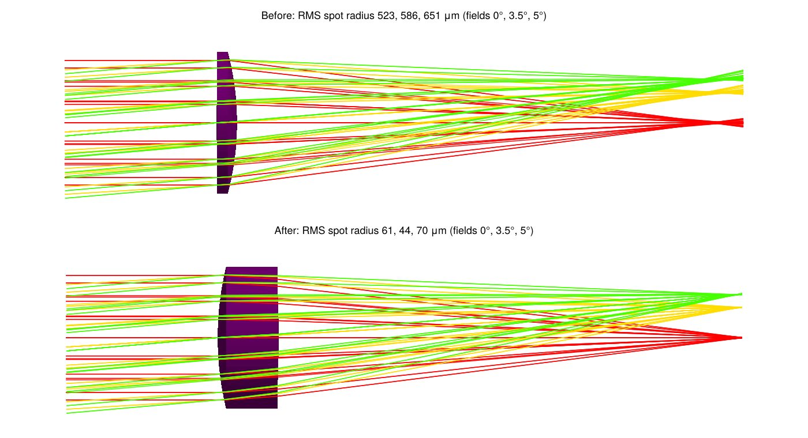
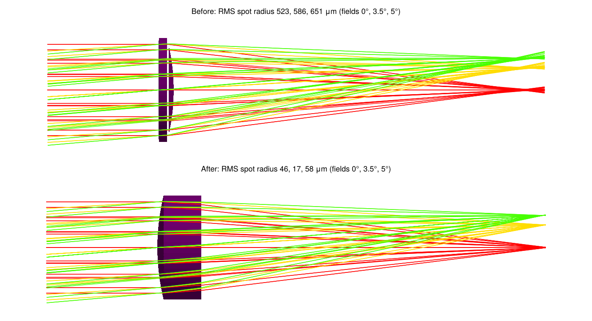
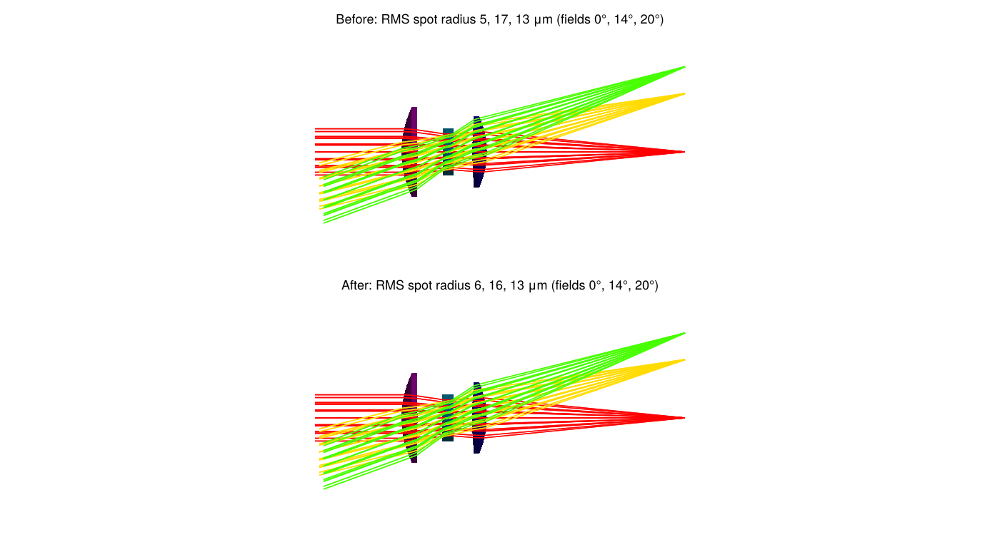
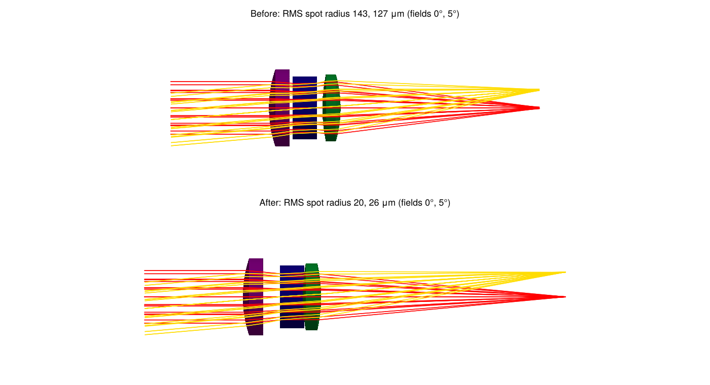

# Optimization

OpticSim systems can be optimized with any Julia optimizer that supports parameter bounds. Optimizing an OpticSim system takes three things:
- a function that builds the system from a vector of parameters;
- a merit function to minimize;
- bounds on every parameter.

The solver enforces the bounds, so a lens thickness or air gap can never leave its allowed range, and you don't have to tune merit weights to keep it there.

The `Examples` module in the repository (`Examples/optimization_examples.jl`) contains four optimization problems, three of them recreated from published Zemax examples. Each is an `OptimizationExample` with:
- the free variables, their starting values and bounds;
- a `build(x)` function returning the optical system;
- a `merit(x)` function: the mean over the fields of the squared RMS spot radius about the centroid.

The merit function works with automatic differentiation, so solvers get exact gradients from ForwardDiff.

## Solving an example

```julia
using OpticSim
using Optimization, OptimizationOptimJL # any Optimization.jl solver package that supports bounds
import ForwardDiff                     # needed for Optimization.AutoForwardDiff()
include("Examples/Examples.jl")          # the Examples module is in the repository, not the package

ex = Examples.singlet_optimization()
f = OptimizationFunction((x, _) -> ex.merit(x), Optimization.AutoForwardDiff())
prob = OptimizationProblem(f, ex.x0; lb=first.(ex.bounds), ub=last.(ex.bounds))
sol = solve(prob, Optim.Fminbox(Optim.LBFGS()))

Examples.rmsspotradii(ex, sol.u)        # RMS spot radius per field, μm
Examples.surfaceseparations(ex, sol.u)  # clearance between neighboring lens surfaces
system = ex.build(sol.u)                # the optimized system, e.g. for Vis.drawtracerays(system)
```

Each field is traced with a hexapolar grid of rays filling the entrance pupil: 127 rays per field and wavelength by default, set with the `rings` keyword of each example (`Examples.singlet_optimization(rings=8)`).

To draw the design before and after, load a Makie backend (see [Visualization](@ref)) and compare the two systems with [`Vis.drawcomparison`](@ref OpticSim.Vis.drawcomparison). `Examples.fieldrays` gives the example's rays with one color per field; an example made with fewer `rings` gives a less cluttered drawing:

```julia
import CairoMakie
drawn = Examples.singlet_optimization(rings=3)
Vis.drawcomparison([drawn.build(ex.x0), drawn.build(sol.u)]; raygenerator=Examples.fieldrays(drawn),
                   titles=["Before", "After"], trackallrays=true, test=true, colorbysourcenum=true)
Vis.save("singlet.png")
```

The drawings below were made this way.

## The examples

| Example | Source | Free variables | RMS spot radius before → after (μm) |
|:--|:--|:--|:--|
| Singlet | Zemax tutorial | 3 | 523, 587, 651 → 61, 44, 70 |
| Aspheric singlet | derived from the Zemax tutorial | 6 | 523, 587, 651 → 46, 17, 58 |
| Cooke triplet, 40° field | Zemax sample file | 8 | 4.9, 17.2, 12.9 → 5.7, 16.0, 13.3 |
| Cooke triplet | OpticSim `cooketriplet` | 8 | 144, 127 → 20, 26 |

The results are from `Fminbox(LBFGS())`; see [Choosing a solver](@ref).

### Singlet

From the Zemax knowledge base tutorial "How To Design a Singlet Lens":
- **Lens:** F/4 N-BK7 singlet, focal length 100mm, entrance pupil 25mm.
- **Fields and wavelength:** 0°, 3.5° and 5°, at 632.8nm.
- **Free:** the front curvature, the center thickness (bounded to the tutorial's 2–12mm) and the distance to the image.
- **Solve:** as in Zemax, the back radius is set by a paraxial F-number solve that keeps the focal length at 100mm.



The tutorial reports final RMS spot radii of 50.1, 46.4 and 82.0μm, measured from the chief ray. OpticSim measures from the centroid and reaches 61, 44 and 70μm. The optimizer finds the center thickness best at its 12mm upper bound. A second local minimum exists near 3.7mm thickness (63, 45, 73μm), which `LBFGSB()` stops at. The tutorial's edge thickness limit of at least 2mm can't be written as a bound; the result's edge thickness is 10mm.

### Aspheric singlet

The singlet above with an even aspheric front surface: its conic and 4th and 6th order terms are free as well. No published asphere example with a complete specification was found, so this one is derived from the singlet tutorial to show what the asphere adds.



The on-axis spot improves from 61 to 46μm and the 3.5° field from 44 to 17μm. The optimizer finds a conic of −1.00, a paraboloid, which focuses collimated light without spherical aberration.

### Cooke triplet, 40° field

The Zemax sample file "Cooke 40 degree field":
- **Aperture and fields:** entrance pupil 10mm; fields 0°, 14° and 20°.
- **Wavelengths:** 0.48, 0.55 and 0.65μm, weighted 0.8, 1 and 0.8.
- **Glasses:** SK16, F2 and SK16. The stop is on the back of the middle lens.
- **Free:** five curvatures, each bounded so its radius stays at least 1% larger than the surface's semi-diameter, both air gaps, and the distance to the image.
- **Solve:** the last radius is set by the sample's F/5 solve, which keeps the focal length at 50mm.



The starting point is the sample's own design, which Zemax has already optimized. OpticSim finds only a 4% lower merit value, so the two programs agree on what is optimal. Both outer lenses have an edge thickness of exactly 1.000mm in the sample, which suggests Zemax optimized it with a 1mm edge thickness constraint.

### Cooke triplet

OpticSim's `cooketriplet` with its five lens radii, both air gaps and the distance to the image free:
- **Radii:** may change by 25%.
- **Air gaps:** 0.5–5mm.
- **Image distance:** 35–55mm.
- **Fields:** 0° and 5° at 0.55μm, entrance pupil 12mm.

`cooketriplet` comes without a field or aperture specification, so these are chosen for the example.



Four variables end at their bounds. One of them is the gap between the second and third lenses, at its 0.5mm minimum, which leaves 0.40mm between the lenses at their edges.

## Bounds and lens geometry

The solver evaluated thousands of points across these runs, and none of them was outside the bounds.

`surfaceseparations(example, x)` checks that no lens intersects itself or its neighbor. For each pair of neighboring surfaces, it gives the smallest axial distance between them across their shared clear aperture, using each surface's full sag (curvature, conic and aspheric terms). In every optimized design all separations are positive.

| Example | Smallest separation | Where |
|:--|:--|:--|
| Singlet | 10.06mm | lens edge thickness |
| Aspheric singlet | 10.08mm | lens edge thickness |
| Cooke triplet, 40° field | 1.00mm | middle lens center thickness (fixed) |
| Cooke triplet | 0.40mm | air gap between lenses 2 and 3, at the edge |

A radius set by a solve, like the Cooke sample's last radius, is not a free variable and can't be bounded. If a solve gives a radius smaller than its surface's semi-diameter, the system can't be built, so the merit function returns `NaN` and the solver backs off.

## Choosing a solver

Both solvers below come from Optimization.jl wrapper packages that enforce bounds. They ran on every example from the same starting point, with ForwardDiff gradients.

| Example | `LBFGSB()`: evaluations, merit | `Fminbox(LBFGS())`: evaluations, merit |
|:--|:--|:--|
| Singlet | 62, 3.79e-3 | 129, 3.52e-3 |
| Aspheric singlet | 94, 2.10e-3 | 777, 1.90e-3 |
| Cooke triplet, 40° field | 42, 1.62e-4 (stopped: "Unstable") | 179, 1.56e-4 |
| Cooke triplet | 74, 1.25e-3 | 2146, 5.37e-4 |

`Fminbox(LBFGS())` reached a lower merit on every example. To check that this holds beyond one starting point, the Cooke triplet problem was also solved from its starting design and four random points within the bounds:

| Start | `LBFGSB()`: evaluations, merit | `Fminbox(LBFGS())`: evaluations, merit |
|:--|:--|:--|
| 1 (the starting design) | 298, 4.64e-3 (stopped: "Unstable") | 34635, 5.61e-3 |
| 2 | 160, 3.04e-3 | 5299, 1.56e-3 |
| 3 | 120, 3.49e-3 | 2716, 1.80e-3 |
| 4 | 288, 2.33e-3 | 29275, 4.59e-3 |
| 5 | 242, 2.66e-3 | 4400, 1.49e-3 |

Neither solver left the bounds in any run. `Fminbox(LBFGS())` found the lower merit in 7 of the 9 runs, but it took 15 to 140 times as many evaluations: up to 22 minutes, against seconds for `LBFGSB()`. Both are local optimizers that often settle in different local minima, so neither always finds the better design.

`Fminbox(LBFGS())` is the recommended solver because it recovers from a trial point where the system can't be built. `LBFGSB()` stops there instead, which is why it made no progress on the Zemax Cooke triplet. `LBFGSB()` is a good choice for quick exploration, for example from several starting points, when every point within the bounds gives a valid system.
