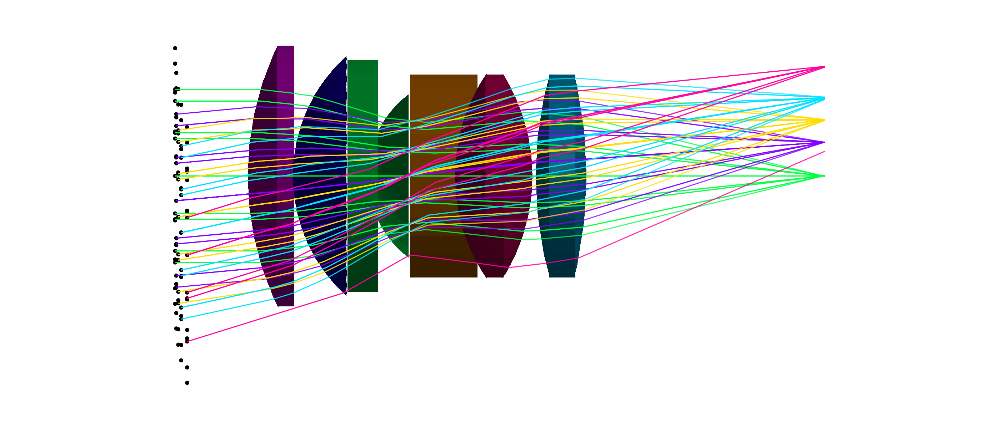
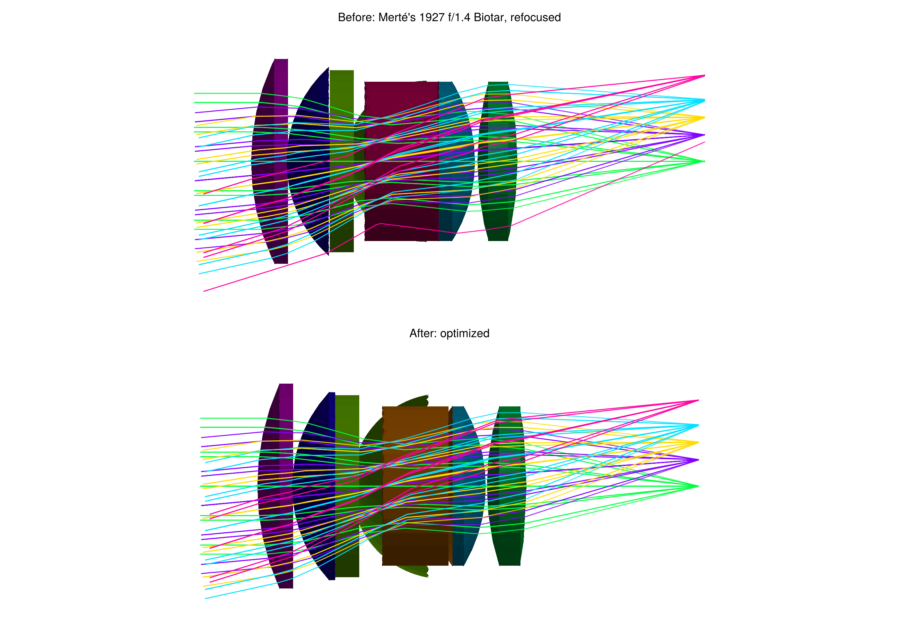

# Optimization

OpticSim systems can be optimized with any Julia optimizer that supports parameter bounds. Optimizing an OpticSim system takes three things:
- a function that builds the system from a vector of parameters;
- a merit function to minimize;
- bounds on every parameter.

The solver enforces the bounds, so a lens thickness or air gap can never leave its allowed range, and you don't have to tune merit weights to keep it there.

The `Examples` module in the repository (`Examples/optimization_examples.jl`) contains five optimization problems: three recreated from published Zemax examples, and Zeiss's 1927 f/1.4 Biotar from its patent. Each is a `LensOptimizationProblem` with:
- the free variables, their starting values and bounds;
- a `build(x)` function returning the optical system;
- a `merit(x)` function: the mean over the fields of the squared RMS spot radius about the centroid.

The merit function works with automatic differentiation, so solvers get exact gradients, from compiled sequential ray Jacobians (see [Fast gradients for sequential lenses](@ref)) or from ForwardDiff. Its rays come from an emitter for each field and wavelength ([`OpticSim.pupilsource`](@ref)): a `Sources.Source` with a hexapolar grid of origins filling the entrance pupil. Only rays that pass through each lens surface once, in order, count, as in a sequential lens design program: OpticSim traces non-sequentially, and light reaching the image by a stray path, such as a reflection inside a thick element, is flare, not part of the image.

## Solving an example

`Examples/run_optimization_examples.jl` has a complete example for each lens: `optimize_singlet()`, `optimize_aspheric_singlet()`, `optimize_cooke40()`, `optimize_cooke_triplet()` and `optimize_biotar()`. Each one creates the optimization problem, solves it and prints the variables before and after, the RMS spot radius per field and the clearance between neighboring lens surfaces. `Examples/Project.toml` has everything they need. Run them all from the repository root with:

```
julia -t auto --project=Examples Examples/run_optimization_examples.jl
```

`-t auto` starts Julia with a thread per core: the merit function traces its rays in parallel. The rays are split into small chunks that the threads take from a shared queue, so fast and slow cores both stay busy, and the result doesn't depend on the number of threads. For the Biotar, 24 threads on a 24-core laptop processor (8 performance and 16 efficiency cores) evaluate the merit 13 times as fast as one thread and its gradient 9 times as fast.

The examples solve their problems with [`optimizelens`](@ref), which is available once Optimization, OptimizationOptimJL and ForwardDiff are loaded. It scales each variable to run from 0 to 1 across its bounds before passing it to the solver. Lens variables have very different scales: a change of 0.001/mm in a curvature affects the image about as much as a change of millimeters in a spacing. Without scaling the gradient is thousands of times larger for curvatures, and a gradient-based solver barely moves the spacings: in an unscaled Biotar optimization the spacings changed by less than a micrometer. Its gradients come from compiled sequential ray Jacobians when the problem has a `prescription` function, as all the examples do (see [Fast gradients for sequential lenses](@ref)); otherwise from ForwardDiff, with `Optimization.AutoForwardDiff(chunksize = length(x0))`, which computes all the derivatives in one pass instead of several.

The core of each example is:

```julia
using OpticSim
using Optimization, OptimizationOptimJL, ForwardDiff # load these to make optimizelens available
include("Examples/Examples.jl")          # the Examples module is in the repository, not the package

ex = Examples.singlet_optimization()
sol = optimizelens(ex)                  # Fminbox(LBFGS()) by default; any bounded solver: optimizelens(ex; solver=...)

rmsspotradii(ex, sol.u)        # RMS spot radius per field, μm
surfaceseparations(ex, sol.u)  # clearance between neighboring lens surfaces
system = ex.build(sol.u)       # the optimized system, e.g. for Vis.drawtracerays(system)
```

Each field is traced with a hexapolar grid of rays filling the entrance pupil: 127 rays per field and wavelength by default, set with the `rings` keyword of each example (`Examples.singlet_optimization(rings=8)`).

To draw the design before and after, load a Makie backend (see [Visualization](@ref)) and compare the two systems with [`Vis.drawcomparison`](@ref OpticSim.Vis.drawcomparison). `fieldrays` gives the example's rays with one color per field; an example made with fewer `rings` gives a less cluttered drawing:

```julia
import CairoMakie
drawn = Examples.singlet_optimization(rings=3)
Vis.drawcomparison([drawn.build(ex.x0), drawn.build(sol.u)]; raygenerator=fieldrays(drawn),
                   titles=["Before", "After"], trackallrays=true, test=true, colorbysourcenum=true)
Vis.save("singlet.png")
```

The drawings below were made this way.

## Fast gradients for sequential lenses

A [`LensOptimizationProblem`](@ref) created with a `prescription` function, the function that gives the lens prescription (a DataFrame) for variables `x`, can have its spot merit and its gradient computed without differentiating through OpticSim's ray tracer. [`optimizelens`](@ref) then does this by default (`gradient = :sequential`), and [`spotmerit_and_gradient`](@ref) does it directly. All the examples give their prescription function. The gradient is exact, the same as ForwardDiff's to about 1e-13, and whole optimizations are many times faster:

| Example | Variables | Rays | Gradient: ForwardDiff → sequential | Optimization: ForwardDiff → sequential | Final merit: ForwardDiff, sequential |
|:--|:--|:--|:--|:--|:--|
| Singlet | 3 | 381 | 8.9ms → 0.4ms (21×) | 11.1s → 1.0s (11×) | 3.5165e-3, 3.5165e-3 |
| Aspheric singlet | 6 | 381 | 5.5ms → 0.5ms (11×) | 26.3s → 1.6s (17×) | 1.9038e-3, 1.9038e-3 |
| Cooke triplet, 40° field | 8 | 1143 | 26ms → 2.0ms (13×) | 20.5s → 1.2s (18×) | 1.5564e-4, 1.5564e-4 |
| Cooke triplet | 8 | 254 | 5.2ms → 0.6ms (9×) | 24.2s → 1.3s (18×) | 5.3696e-4, 5.3696e-4 |
| Zeiss Biotar f/1.4 | 20 | 3255 | 336ms → 27ms (13×) | 29 minutes → 76s (23×) | 3.452e-3, 3.469e-3 |

Both ways use `Fminbox(LBFGS())` from the same starting point, with 8 threads, on a laptop that was also running another long computation, so the times are slower than on an idle machine; the ratios are what matter. The optimizations need fewer evaluations with sequential gradients as well, because line search steps compute only the merit, without its gradient. Four of the optimizations end at the same design; the Biotar's took a slightly different path and stopped 0.5% higher. The gradient for the Biotar is dominated by its prescription function (the focal length solve, aiming the rays at the pupil, sizing the clear apertures), which ForwardDiff still differentiates; tracing the rays and evaluating their Jacobians takes a few milliseconds.

The prescription function must describe the same lens as `build(x)`, and `merit(x)` must be the spot merit of that prescription traced with `aimedrays(x)`; the constructor checks that the two merits agree at the starting values. The sequential gradient supports what the examples use: Standard and Aspheric surfaces (conics with even aspheric terms), flat surfaces, stops in air and a flat image. For any other merit function, or other surface types, use `gradient = :forwarddiff`, which differentiates `merit(x)` with ForwardDiff.

### How it works

A ray that passes every surface of a sequential lens in order goes through the same chain of operations whatever the ray and whatever the lens parameters: intersect the first surface, refract, intersect the next surface, refract, ..., intersect the image. So the map

    (lens parameters θ, ray start o and direction d, intersection parameters t₁, t₂, ...) -> (x, y) on the image

is one fixed expression for each lens layout, the number and kind of its surfaces. θ holds every surface's curvature, conic, aspheric coefficients and vertex position ([`OpticSim.sequentiallens`](@ref)). The expression is built symbolically with FastDifferentiation, the first time a layout is used, together with its Jacobian ∂(x, y)/∂[θ; o; d], and compiled ([`OpticSim.sequentialjacobian`](@ref)). Each ray then takes two steps:

1. Trace it numerically ([`OpticSim.sequentialtrace`](@ref)): at each curved surface, Newton's method finds the parameter t at which the ray o + t d meets the surface. The tⱼ are recorded. The trace also decides whether the ray takes the sequential path at all: it fails if the ray misses a surface, falls outside a clear semi-diameter or is totally internally reflected.
2. Evaluate the compiled function with θ, o, d and the recorded tⱼ. It returns the image point and its Jacobian.

The merit's gradient with respect to θ and to each ray's start follows from the Jacobians. The chain rule to the optimization variables x is a single ForwardDiff pass through the prescription function and the aimed rays, which traces no rays. On the examples the compiled Jacobian takes about 3μs per ray and the numeric trace about 1.3μs.

#### The Newton step that makes the derivative exact

The image point depends on θ in two ways: directly, through the surface shapes, positions and refraction, and through the intersection parameters. The ray meets surface j at P = o + t d, where t solves the intersection equation

    F(t, θ) = P_z(t) - z_vertex + s(r²(t)) = 0

with s the surface's sag. No formula gives t, so the derivative of the image point is

    dx/dθ = ∂x/∂θ + ∂x/∂t ⋅ dt/dθ

and the numeric trace gives the value of t but not dt/dθ. If the compiled function took t as a constant input, FastDifferentiation would return only ∂x/∂θ, which is wrong: each intersection slides along the ray when its surface moves.

The derivative of t comes from the implicit function theorem. Differentiating F(t(θ), θ) = 0 with respect to θ,

    F_t ⋅ dt/dθ + F_θ = 0,   so   dt/dθ = -F_θ / F_t

It needs only the derivatives of F at the solution, not the iterations that found it.

The compiled function produces this derivative without being told about it. It doesn't use the recorded t directly. It first takes one Newton step,

    t̂(t, θ) = t - F(t, θ) / F_t(t, θ)

and uses t̂ everywhere after. At the recorded root, where F = 0:

- the value is t̂ = t - 0/F_t = t, so the step changes nothing numerically;
- the derivative with respect to the input t is ∂t̂/∂t = 1 - (F_t² - F F_tt)/F_t² = F F_tt / F_t² = 0, so whatever t is passed in, t̂ doesn't respond to it, and it costs nothing that t is a constant input;
- the derivative with respect to θ, with t held fixed, which is all FastDifferentiation sees, is ∂t̂/∂θ = -F_θ/F_t + F (∂F_t/∂θ)/F_t² = -F_θ/F_t. The second term vanishes because F = 0, and what is left is the implicit function theorem's dt/dθ.

So differentiating t̂ symbolically, with t a frozen number, gives the same derivative as differentiating through the converged Newton iteration. The single step is the implicit function theorem in a form that symbolic differentiation handles by itself. The chain rule then carries each dtⱼ/dθ through all the later surfaces to the image point. Planes, stops and the image need no step: their intersection t = (z - o_z)/d_z is an explicit formula.

Two conditions apply. The recorded t must be a converged root, because ∂t̂/∂t = 0 needs F = 0; the numeric trace iterates until the Newton update is below 1e-13 (1 + |t|), so what is left is at roundoff level. And the derivative is exact to first order only: second derivatives (a Hessian) would need more than one Newton step's terms. A gradient-based optimizer needs only first derivatives.

The compiled expression is fixed for a layout: one Newton step per curved surface and no loops or branches, so it is compiled once and every ray that reaches the image uses it. The iteration happens in the cheap numeric trace, in plain floating point. ForwardDiff, in contrast, carries every partial derivative through every Newton iteration and through OpticSim's general intersection code.

## The examples

| Example | Source | Free variables | RMS spot radius before → after (μm) |
|:--|:--|:--|:--|
| Singlet | Zemax tutorial | 3 | 523, 587, 651 → 61, 44, 70 |
| Aspheric singlet | derived from the Zemax tutorial | 6 | 523, 587, 651 → 46, 17, 58 |
| Cooke triplet, 40° field | Zemax sample file | 8 | 4.9, 17.2, 12.9 → 5.7, 16.0, 13.3 |
| Cooke triplet | OpticSim `cooketriplet` | 8 | 144, 127 → 20, 26 |
| Zeiss Biotar f/1.4 | patent DE 485,798 (1927) | 20 | 111, 80, 119, 149, 151 → 43, 48, 69, 68, 73 |

The results are from `Fminbox(LBFGS())`; see [Choosing a solver](@ref). The Biotar's are with scaled variables, the others' without.

### Singlet

From the Zemax knowledge base tutorial "How To Design a Singlet Lens":
- **Lens:** F/4 N-BK7 singlet, focal length 100mm, entrance pupil 25mm.
- **Fields and wavelength:** 0°, 3.5° and 5°, at 632.8nm.
- **Free:** the front curvature, the center thickness (bounded to the tutorial's 2–12mm) and the distance to the image.
- **Solve:** as in Zemax, the back radius is set by a paraxial F-number solve that keeps the focal length at 100mm.


The tutorial reports final RMS spot radii of 50.1, 46.4 and 82.0μm, measured from the chief ray. OpticSim measures from the centroid and reaches 61, 44 and 70μm. The optimizer finds the center thickness best at its 12mm upper bound. A second local minimum exists near 3.7mm thickness (63, 45, 73μm), which `LBFGSB()` stops at. The tutorial's edge thickness limit of at least 2mm can't be written as a bound; the result's edge thickness is 10mm.

### Aspheric singlet

The singlet above with an even aspheric front surface: its conic and 4th and 6th order terms are free as well. No published asphere example with a complete specification was found, so this one is derived from the singlet tutorial to show what the asphere adds.


The on-axis spot improves from 61 to 46μm and the 3.5° field from 44 to 17μm. The optimizer finds a conic of −1.00, a paraboloid, which focuses collimated light without spherical aberration.

### Cooke triplet, 40° field

The Zemax sample file "Cooke 40 degree field":
- **Aperture and fields:** entrance pupil 10mm; fields 0°, 14° and 20°.
- **Wavelengths:** 0.48, 0.55 and 0.65μm, weighted 0.8, 1 and 0.8.
- **Glasses:** SK16, F2 and SK16. The stop is on the back of the middle lens.
- **Free:** five curvatures, each bounded so its radius stays at least 1% larger than the surface's semi-diameter, both air gaps, and the distance to the image.
- **Solve:** the last radius is set by the sample's F/5 solve, which keeps the focal length at 50mm.


The starting point is the sample's own design, which Zemax has already optimized. OpticSim finds only a 4% lower merit value, so the two programs agree on what is optimal. Both outer lenses have an edge thickness of exactly 1.000mm in the sample, which suggests Zemax optimized it with a 1mm edge thickness constraint.

### Cooke triplet

OpticSim's `cooketriplet` with its five lens radii, both air gaps and the distance to the image free:
- **Radii:** may change by 25%.
- **Air gaps:** 0.5–5mm.
- **Image distance:** 35–55mm.
- **Fields:** 0° and 5° at 0.55μm, entrance pupil 12mm.

`cooketriplet` comes without a field or aperture specification, so these are chosen for the example.


Four variables end at their bounds. One of them is the gap between the second and third lenses, at its 0.5mm minimum, which leaves 0.40mm between the lenses at their edges.

### Zeiss Biotar f/1.4

Willy Merté's Biotar for Carl Zeiss Jena, 1927, is regarded as the first double Gauss lens: six elements in four groups, a singlet, a cemented doublet, the stop, a cemented doublet and a singlet. `Examples.biotar()` is the lens, `Examples.biotar_optimization()` the optimization problem.



#### Reconstructing the prescription

The prescription is Example 2 of the patent, DE 485,798 (US 1,786,916), normalized to a 100mm focal length. Neither patent is available as clean text: the numbers come from the OCR text of the scanned German patent, which is garbled in places. The reconstruction was checked by tracing it:

- **Example 2 as read** has ten radii, nine thicknesses and the patent's glasses (nd and ν). Its glass assignment follows the structure: I in the front singlet, II and III in the front doublet, IV and V in the rear doublet, VI in the rear singlet.
- **One radius is corrected.** The cemented surface r4 reads −115.0. Every other radius of Example 2 is Example 1's scaled by 0.967 to 0.970, and Example 1's r4 is −1118.78, a nearly flat cemented surface, so r4 is taken as −1082. With −115 the paraxial focal length is 98.95mm and the second element would have a negative edge thickness at f/1.4; with −1082 the focal length is 99.9mm, the patent's 100.
- **The glasses** are modelled from the patent's nd and ν with `AGFFileReader.modelglass`.
- **Clear apertures and the stop position are not in the patent.** The deep inner surfaces 5 and 6 meet at a height of about 22.8mm, which limits them to 22.5mm, and a stop large enough for f/1.43, 22.2mm in radius, fits between them only 10.75 to 11.86mm after surface 5; it is placed at 11.3mm. The other clear apertures pass that beam. At the edge of the f/1.4 beam the second element comes to a knife edge, so the patent lens loses its outermost axial rays.
- **The image distance is not in the patent either**; the baseline is the patent lens refocused for the merit function below (65.5mm).

The traced lens confirms the reconstruction: a narrow axial beam comes to a 4μm RMS spot, and the five field bundles focus as above.

#### The optimization

- **Fields:** 0°, 5.3°, 8.8°, 12.3° and 17.3°: relative field heights 0, 0.3, 0.5, 0.7 and 1 of a 17.3° half field. The first f/1.4 Biotar was a 5cm lens for 35mm cine film, whose silent-era full aperture (before optical soundtracks) was 0.980 x 0.735in, 24.89 x 18.67mm, 4:3, with a 31.1mm diagonal: atan(15.56/50) = 17.3°.
- **Wavelengths:** the F, d and C lines, 486.1, 587.6 and 656.3nm, equally weighted.
- **Rays:** f/1.4 beams from an emitter per field and wavelength, aimed at the paraxial entrance pupil of each design, so the beams follow the stop when it and the groups in front of it move. 217 rays per field and wavelength, 3255 in all; the final result is from 631 per field and wavelength, about 9500 in all.
- **Free (20 variables):** the curvatures of the first nine surfaces (within 25%), the five spacings of the four groups, the stop and the image (group 1 to group 2, group 2 to the stop, the stop to group 3, group 3 to group 4, and the last surface to the image), and the six glass thicknesses (within 10%). Each cemented surface is one radius shared by its two elements. The last radius is set by a paraxial solve that keeps the focal length at the patent lens's 99.9mm, so the optimizer can't trade focal length, and with it f-number, for image quality.
- **Clear apertures follow the design** ([`OpticSim.passaxialbeam`](@ref)): each surface is made at least large enough for the f/1.4 axial beam, found by a real ray trace, so only the stop limits that beam. With fixed clear apertures the optimizer found it could improve the spots by letting surface 5 cut off the outer zone of the axial beam, stopping the lens down to about f/1.5. The clear apertures never shrink below the patent lens's, so the element rims still vignette the off-axis beams.



RMS spot radius in μm, with 1261 rays per field and wavelength, a denser sampling than the optimization's:

| | 0° | 5.3° | 8.8° | 12.3° | 17.3° | Merit (mm²) |
|:--|:--|:--|:--|:--|:--|:--|
| Patent, refocused | 111 | 80 | 119 | 149 | 151 | 1.56e-2 |
| Optimized | 43 | 48 | 69 | 68 | 73 | 3.78e-3 |

The optimized lens's merit is 76% lower, with the same focal length, glasses and aperture. It passes all of the axial beam the patent lens passes and more of each off-axis bundle: it didn't improve by vignetting rays. The optimizer used every kind of variable:

- **Radii:** within 15% of the patent's, except the last, set by the focal length solve, which went from −120 to −164.
- **Spacings:** the space between the front and rear doublets, where the stop is, opened from 18.9 to 21.6mm, with the stop 12.7mm behind the front doublet instead of 11.3mm. The gap between the rear groups closed from 0.97 to 0.58mm, and the image moved 3.9mm closer.
- **Clear apertures:** surface 5 grew from 22.5 to 22.8mm to pass the axial beam.
- **Glass thicknesses:** all within 3% of the patent's.

Merté designed the lens by hand, with logarithm tables, for 1920s glass, and corrected it for his own priorities, not this merit function. The comparison shows what a modern optimizer does with the same glasses and layout, not that the patent lens was poor.

## Bounds and lens geometry

The solver evaluated thousands of points across these runs, and none of them was outside the bounds.

`surfaceseparations(example, x)` checks that the lens can be built: that the parts of the system are in order along the axis at every height. No element may be thinner than zero anywhere, and none may pass into the next element, the stop or the image. It checks the parts as OpticSim builds them:
- each element has the radius of the larger of its two surfaces' semi-diameters;
- a spherical surface with a smaller semi-diameter ends there, and a flat ring runs from its edge to the element's rim, as on a real lens whose surfaces have different clear apertures;
- the stop is opaque outside its hole.

At each height a part is checked against whatever comes next there, so the rim of a large element is also checked against the stop or element beyond a smaller neighbor. The merit function rejects a design that fails the check (see below). In every optimized design all clearances are positive.

| Example | Smallest separation | Where |
|:--|:--|:--|
| Singlet | 10.06mm | lens edge thickness |
| Aspheric singlet | 10.07mm | lens edge thickness |
| Cooke triplet, 40° field | 1.00mm | middle lens center thickness (fixed) |
| Cooke triplet | 0.40mm | air gap between lenses 2 and 3, at the edge |
| Zeiss Biotar f/1.4 | 0.58mm | air gap between the rear groups, at the center |

A radius set by a solve, like the Cooke sample's last radius, is not a free variable and can't be bounded. If a solve gives a radius smaller than its surface's semi-diameter, or the parts of a design intersect, the system can't be built, so the merit function returns `NaN` and the solver backs off.

## Choosing a solver

Both solvers below come from Optimization.jl wrapper packages that enforce bounds. They ran on every example from the same starting point, with ForwardDiff gradients; the times in this section are for ForwardDiff gradients, and the sequential gradients make them many times shorter.

| Example | `LBFGSB()`: evaluations, merit | `Fminbox(LBFGS())`: evaluations, merit |
|:--|:--|:--|
| Singlet | 62, 3.79e-3 | 129, 3.52e-3 |
| Aspheric singlet | 94, 2.10e-3 | 777, 1.90e-3 |
| Cooke triplet, 40° field | 42, 1.62e-4 (stopped: "Unstable") | 179, 1.56e-4 |
| Cooke triplet | 74, 1.25e-3 | 2146, 5.37e-4 |

`Fminbox(LBFGS())` reached a lower merit on every example. To check that this holds beyond one starting point, the Cooke triplet problem was also solved from its starting design and four random points within the bounds:

| Start | `LBFGSB()`: evaluations, merit | `Fminbox(LBFGS())`: evaluations, merit |
|:--|:--|:--|
| 1 (the starting design) | 298, 4.64e-3 (stopped: "Unstable") | 34635, 5.61e-3 |
| 2 | 160, 3.04e-3 | 5299, 1.56e-3 |
| 3 | 120, 3.49e-3 | 2716, 1.80e-3 |
| 4 | 288, 2.33e-3 | 29275, 4.59e-3 |
| 5 | 242, 2.66e-3 | 4400, 1.49e-3 |

Neither solver left the bounds in any run. `Fminbox(LBFGS())` found the lower merit in 7 of the 9 runs, but it took 15 to 140 times as many evaluations: up to 22 minutes, against seconds for `LBFGSB()`. Both are local optimizers that often settle in different local minima, so neither always finds the better design.

`Fminbox(LBFGS())` is the recommended solver because it recovers from a trial point where the system can't be built. `LBFGSB()` stops there instead, which is why it made no progress on the Zemax Cooke triplet. `LBFGSB()` is a good choice for quick exploration, for example from several starting points, when every point within the bounds gives a valid system.

On the Biotar, with scaled variables and the 20 variable problem (3255 rays per evaluation). This comparison was run before surfaces ended at their own clear apertures and before the clear apertures followed the design, so its merits are a little higher than the final result above; it shows how the solvers behave, not the final design:

| Solver | Result | Merit (start 1.72e-2) | Evaluations, of them NaN | Time, one thread |
|:--|:--|:--|:--|:--|
| `Fminbox(LBFGS())` | Success | 4.12e-3 | 2748, 2 | 28 minutes |
| Ipopt, limited memory Hessian | stopped at its iteration limit | 4.89e-3 | 15291, 10592 | 16 minutes |
| `LBFGSB()` | stopped at its first NaN: "Unstable" | no progress | | |

Ipopt, through OptimizationMOI, handles bounds directly and backs off from NaN, but spent most of its evaluations on designs whose surfaces cross. With 8 threads on the performance cores the `Fminbox(LBFGS())` optimization took 4.2 minutes, and 24 threads make each gradient another 1.6 times as fast.

## Optimization functions

`src/optimization.jl` has the functions the examples are built from. They are general: use them to set up and solve your own lens optimization problems. The exported ones are in the [Complete Reference](@ref); the others are called with the `OpticSim.` prefix.

### Setting up and solving a problem

| Function | What it does | When to use it |
|---|---|---|
| [`LensOptimizationProblem`](@ref) | Holds a problem: variable names, starting values, bounds, `build(x)`, `merit(x)`, field angles and rays, and optionally `prescription(x)`. Checks that every starting value is inside its bounds, and that a prescription's spot merit is `merit`. | To describe your own problem, so that `optimizelens` and the reporting functions below work with it. See `Examples/optimization_examples.jl` for five complete ones. Give `prescription` for fast exact gradients. |
| [`optimizelens`](@ref) | Solves a problem with Optimization.jl, by default with `Fminbox(LBFGS())`, with each variable scaled to run from 0 to 1 across its bounds. Gradients from compiled sequential ray Jacobians if the problem has a prescription, otherwise ForwardDiff (`gradient = :sequential` or `:forwarddiff` chooses). Needs Optimization, OptimizationOptimJL and ForwardDiff to be loaded. | To optimize. The scaling matters whenever the variables have different units, e.g. curvatures and spacings; without it, gradient solvers barely move the spacings. Pass `solver=` to try a different bounded solver. |
| [`spotmerit_and_gradient`](@ref) | The spot merit and its exact gradient from compiled sequential ray Jacobians. Needs ForwardDiff to be loaded. | To evaluate or check a design's gradient, or to use another optimization package. |
| [`OpticSim.sequentiallens`](@ref), [`OpticSim.sequentialtrace`](@ref), [`OpticSim.sequentialjacobian`](@ref) | A prescription's sequential lens and its parameters θ; the numeric sequential trace of a ray; the compiled image point and Jacobian of a lens layout. | To write another merit function with fast exact gradients, from the image points and their Jacobians. |

### Rays

| Function | What it does | When to use it |
|---|---|---|
| [`OpticSim.pupilsource`](@ref) | An emitter (`Sources.Source`) for one field angle and wavelength: a collimated beam whose origins are a hexapolar grid filling the entrance pupil. | To create the rays for a field. The grid samples the whole pupil evenly, so no part of the aperture is missed. Increase `rings` until the merit stops changing. |
| `OpticSim.pupilrays` | The rays of `pupilsource` for several wavelengths, as (ray, weight) pairs. | To build each field's ray list for a merit function, with the wavelengths weighted. |
| `OpticSim.entrancepupildistance` | The paraxial position of the entrance pupil: the image of the stop formed by the surfaces in front of it. | When the curvatures or spacings in front of the stop are variables, the pupil moves as they change. Recompute it for each design (an `aimedrays(x)` function) so the beam keeps filling the stop. |
| [`fieldrays`](@ref) | A problem's rays at its middle wavelength, numbered by field. | To draw a design with each field in its own color (`colorbysourcenum=true`). |

### Merit function

| Function | What it does | When to use it |
|---|---|---|
| `OpticSim.spotmerit` | The mean over the fields of the squared RMS spot radius, in mm². NaN if the design can't be built (`validsurfaces`, `surfacescross`). | As the merit function of an imaging lens. NaN makes the solver reject the step and backtrack. |
| [`OpticSim.fieldhits`](@ref) | Traces the rays of every field in parallel and returns, per field, where each ray reaches the image, with its weight. Keeps only rays that pass through each lens surface once, in order. | To write a different merit function: distortion, chief ray position, encircled energy, and so on. It does the threading and the filtering of stray paths for you. |
| `OpticSim.rmsradius` | The weighted RMS radius of image points about their centroid. | With `fieldhits`, for the spot size of one field. |
| `OpticSim.lenssurfaces` | The number of surfaces a ray refracts at on its sequential path. | `fieldhits` uses it to keep only the sequential rays. |
| [`rmsspotradii`](@ref) | The RMS spot radius of each field of a problem, in μm. | To report on a design, before and after optimizing. |

### Paraxial solves and bounds

| Function | What it does | When to use it |
|---|---|---|
| `OpticSim.paraxialtrace` | A paraxial (y, nu) ray trace through a list of curvatures, thicknesses and refractive indices. | The basis of the other paraxial functions; also for first-order properties of your own. |
| `OpticSim.lastcurvature` | The curvature of the last surface that gives the lens a chosen focal length. | To hold the focal length fixed while the other curvatures vary, like Zemax's F number solve. It removes one variable and a constraint. |
| `OpticSim.maxcurvature` | The largest curvature a surface can have and still reach its semi-diameter, with a 1% margin. | To set bounds on curvature variables. |
| [`OpticSim.axialrayheights`](@ref) | A real ray trace, in the meridional plane, of a ray parallel to the axis: its height at each surface. | To find how large each surface must be to pass the axial beam. |
| [`OpticSim.passaxialbeam`](@ref) | A copy of a prescription with each surface's semi-diameter raised, if needed, to pass the axial beam (limited by the stop if the stop is smaller). | In `build(x)`, so the clear apertures follow the design like a lens design program's automatic semi-diameters. Without it a fixed semi-diameter can clip the axial beam once the design changes, and the optimizer can improve the spots by stopping the lens down. |

### Lens geometry

| Function | What it does | When to use it |
|---|---|---|
| `OpticSim.validsurfaces` | Checks that every surface's curvature and conic let it reach its semi-diameter. | In a merit function, for designs whose curvature is set by a solve rather than bounded directly. |
| [`OpticSim.surfacescross`](@ref) | Checks that the parts of the system are in order along the axis at every height: no element is thinner than zero anywhere, and none passes into the next element, the stop or the image. Follows how OpticSim builds elements, including a surface continuing past its own semi-diameter to its element's rim. | In a merit function: a solver that moves curvatures and spacings freely will otherwise find designs that can't be built. `spotmerit` already calls it. |
| [`surfaceseparations`](@ref) | The clearances that `surfacescross` checks, with the smallest value of each and where it occurs. | To check an optimized design's glass edge thicknesses and air gaps, or to find out why a design was rejected. |
| `OpticSim.prescriptionsag` | The sag of a prescription surface at a height: conic plus even aspheric terms. | To work out lens shapes from a prescription without building the system. |

```@docs
OpticSim.pupilsource
OpticSim.fieldhits
OpticSim.surfacescross
OpticSim.axialrayheights
OpticSim.passaxialbeam
OpticSim.SequentialLens
OpticSim.sequentiallens
OpticSim.sequentialtrace
OpticSim.sequentialjacobian
```
